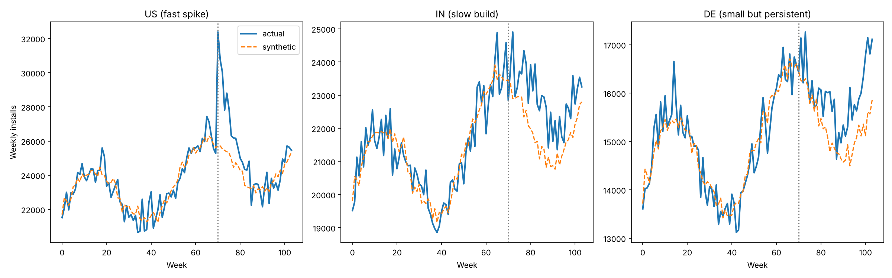

# Geo-Incrementality Test Simulator

Can a geo test recover a campaign's true incremental effect? This repo tests the method on synthetic data where the right answer is known, before trusting it with real budget decisions.

Attribution and platform-reported ROAS credit conversions that followed an ad, whether or not the ad caused them. An incrementality test estimates what would have happened without the ads, but the test itself needs validating.

**All data are synthetic. They do not describe any real company, product or campaign.**

## Results

US, fast-spike scenario (13 donor countries, 70 pre-period weeks, 34 post-period weeks):

| Check | Value |
|---|---|
| Pre-period fit (MAPE) | 2.12% |
| Estimated lift, synthetic control (scipy) | +4.01% |
| Estimated lift, synthetic control (`pysyncon`, with spend as predictors) | +4.50% |
| Estimated lift, unconstrained regression on the same donors | +4.29% |
| **True lift (hidden in the data)** | **+4.20%** |
| Placebo rank (post/pre RMSPE ratio) | 1 of 14, p ≈ 0.071 (the lowest possible with 13 donors) |
| Minimum detectable effect (80% power, α = 0.10) | about 11% (a conservative approximation, see below) |

All three estimates landed within about 0.3 pp of the hidden answer. That checks the method and the code on an easy panel, where every country shares one trend and seasonal pattern with independent noise; it does not measure any real campaign.

The last two rows look contradictory: the test ranked the US first, yet the simulated minimum detectable effect is about 11%. Two things differ. The significance test ranks the post/pre RMSPE ratio, which scales each market's gap by its own pre-period fit, and the US effect is a spike (+22% in week 70, +4.2% on average). The power simulation, kept simple, adds a constant effect to placebo average effects and ignores fit. One placebo drives it: JP, the largest market, is bigger than every donor available to it (failure 2 again), so its gap of about +10% is there before week 70 as well as after. The ratio discounts that gap; the simulation counts it as noise, so smaller effects rarely rank first. On this panel the simulated MDE is therefore conservative. Before a real test, I would simulate power with the same statistic and a realistic effect shape, and drop placebos that sit outside their donors' range.

All three effect shapes:

| Country | Effect shape | Pre-period MAPE | Estimated lift | True lift | Gap |
|---|---|---|---|---|---|
| US | fast spike | 2.12% | +4.01% | +4.20% | −0.2 pp |
| IN | slow build | 1.99% | +4.67% | +5.11% | −0.4 pp |
| DE | small but persistent | 1.80% | +4.33% | +3.67% | +0.7 pp |



## What it does

1. **Synthetic panel.** 16 countries × 104 weeks of weekly installs. Three countries start a campaign in week 70, each with a different effect shape. The true weekly lift is stored in a ground-truth column used only for grading.
2. **Counterfactual with synthetic control.** A weighted mix of the 13 untreated countries (weights between 0 and 1, summing to 1) that tracks the treated country before the campaign. After the campaign starts, the gap between the two is the estimated lift.
3. **Significance with placebo tests.** The same analysis is rerun on each untreated country as if it had been treated. The real result is ranked among these placebo results.
4. **Power and minimum detectable effect by simulation.** Hypothetical effects are added to the placebo noise to see how often the test would detect them.
5. **Cross-checks.** The `pysyncon` package and an unconstrained regression on the same donors (CausalImpact's regression component alone, without its time-series model or priors).

## Five silent failures this project exposed

None of these raised an error.

1. **The optimizer didn't move.** With outcomes in the tens of thousands, the problem was badly scaled, and the optimizer stopped with the weights near their starting values. Fix: rescale the data and supply an analytic gradient.
2. **The target was unreachable.** A bug in the data generator pushed the treated country above every donor, outside their range (the convex hull). No combination of weights between 0 and 1 summing to 1 can reach it, and the first estimate was over +400%. Fix: keep treated units within the donors' range.
3. **The placebo fit filter was on the wrong scale.** Abadie et al. (2010) drop placebos whose pre-period MSPE (mean squared prediction error) is more than 20, 5 or 2 times the treated unit's. My first version applied 5× to RMSPE, which is 25× in MSPE terms, so the smallest country, with a −22% pseudo-effect, passed. Fix: a scale-free filter on pre-period MAPE, labeled as an adaptation. At 5× it is still looser than the original, which is why JP stays in.
4. **Power came out at 0%.** The power simulation's noise still included the smallest country's −22% pseudo-effect, which the fit filter is meant to remove, so effects up to about 12% could never rank first. Fix: apply the same filter there.
5. **One wrong number spread.** The notes said 12 donors, so the lowest possible p was written as 1/13 ≈ 0.077. The panel has 13, so it is 1/14 ≈ 0.071 (1/13 applies only after the fit filter drops one placebo). Only re-running the code caught it.

## Beyond the code

- [`docs/executive_summary_example.md`](docs/executive_summary_example.md): the result written up for a non-technical decision-maker, on one page.
- [`docs/choosing_a_design.md`](docs/choosing_a_design.md): where a geo test fits, what to do when there is no comparison group, and how to reconcile a lift estimate with year-over-year numbers.

## How it was built

I designed the test and checked each estimate against the known answer. The code was written with AI assistance and reviewed by hand, and every number quoted here comes from running it.

## Run it

```bash
pip install -r requirements.txt
python data/generate_synthetic_data.py         # writes data/synthetic_geo_panel.csv
python notebooks/synthetic_control_analysis.py  # US: fit, lift, chart
python notebooks/all_markets_analysis.py        # all three effect shapes
python notebooks/causalimpact_lite.py           # cross-check: unconstrained regression
python notebooks/pysyncon_official.py           # cross-check: pysyncon
```

The full pipeline, including the placebo test and the power simulation:

```bash
python skill/geo-incrementality-test-design/scripts/run_geo_incrementality.py \
  --data data/synthetic_geo_panel.csv --unit-col country --period-col week \
  --outcome-col installs --treated US --intervention 70 --exclude IN DE --power
```

On your own data, use any long-format CSV with one row per unit and period.

## Agent skill

`skill/geo-incrementality-test-design/` packages the workflow as a reusable AI agent skill: instructions (`SKILL.md`), the pipeline script, references with every threshold labeled [SOURCED] or [HEURISTIC], and an executive-summary template.

## Structure

```
data/        synthetic data generator and the generated panel
notebooks/   synthetic control, three effect shapes, cross-checks, charts
skill/       agent skill: instructions, pipeline script, references, template
docs/        one-page stakeholder summary, choosing a measurement design
```

## In production

Prefer maintained packages such as `pysyncon` (Python), Google's `CausalImpact` (R) or Meta's `GeoLift` (R). The code here shows how the method works; it is not a replacement for them.

## License

MIT
